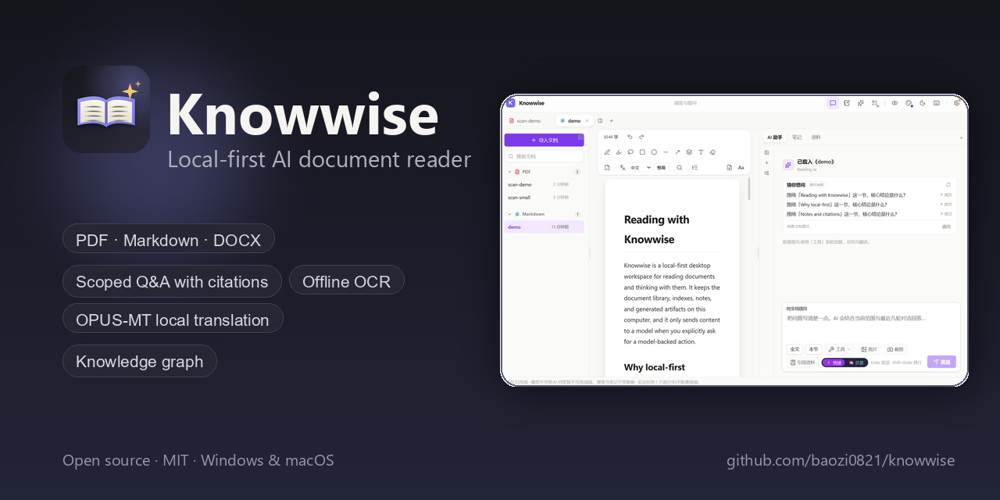
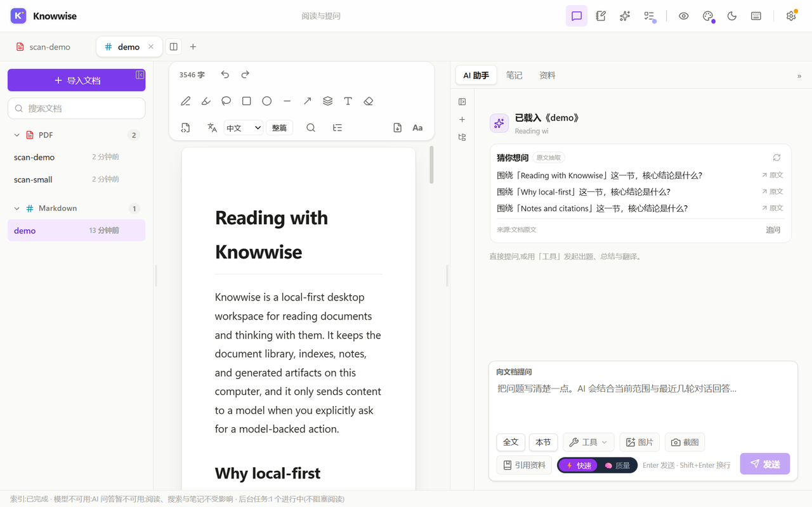
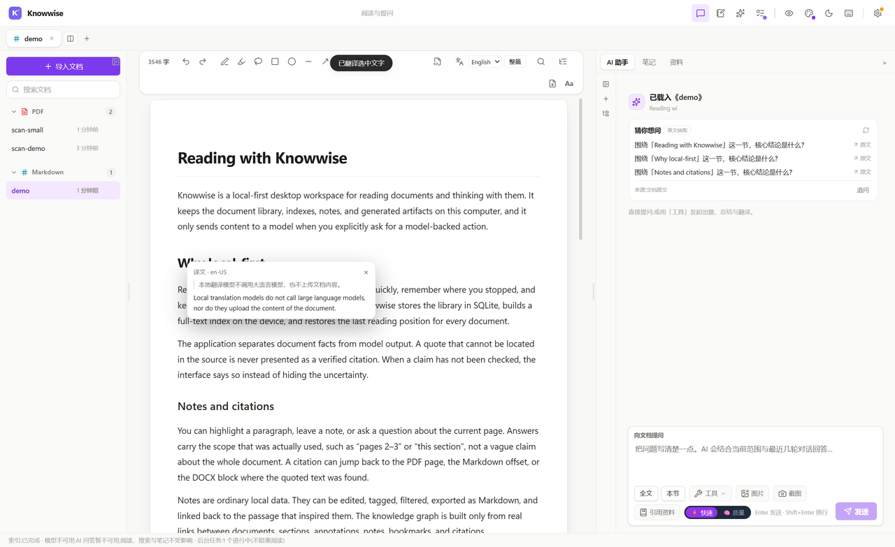
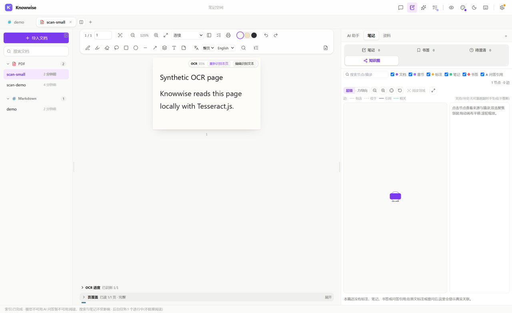
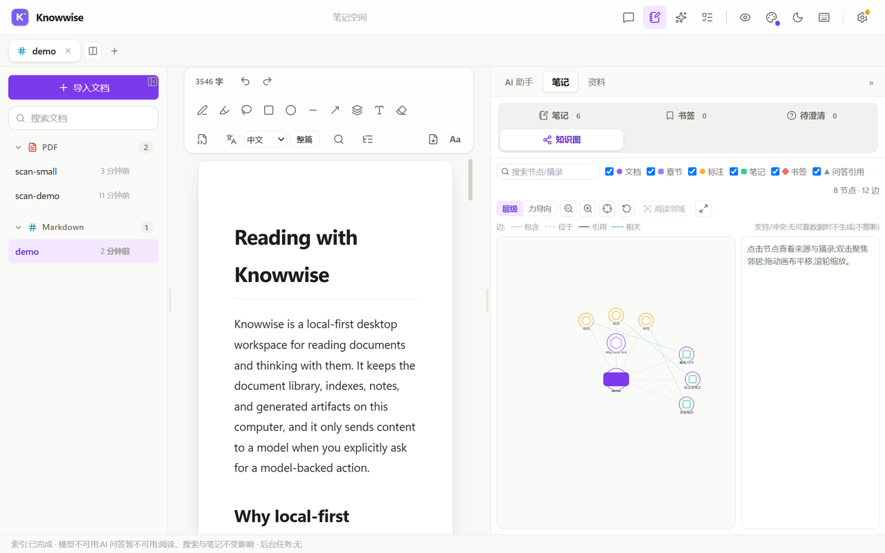
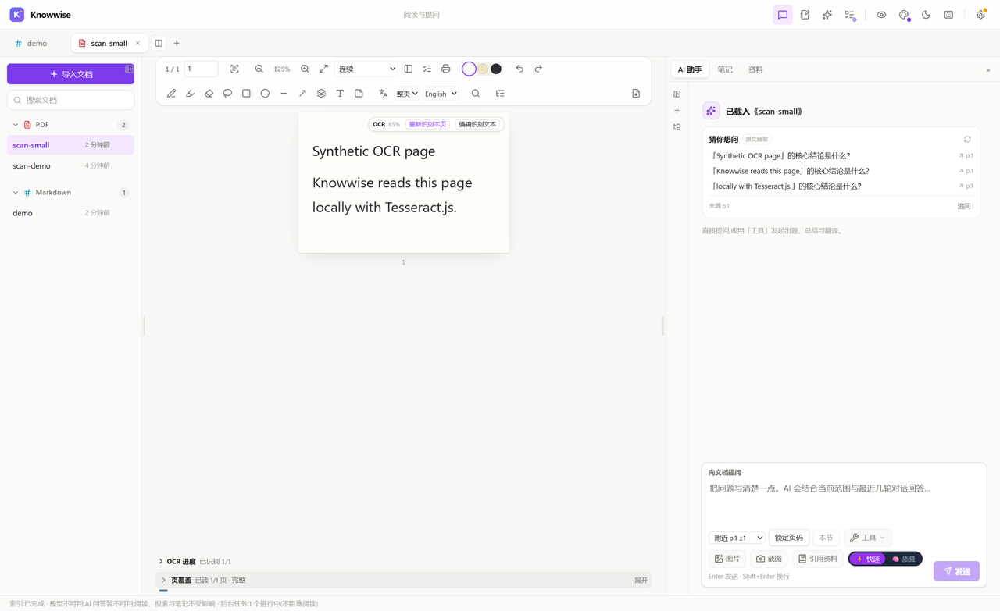
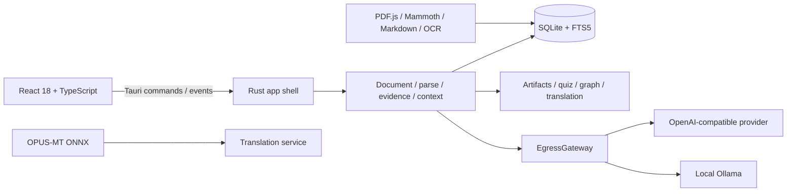

<div align="center">
  
  <h1>Knowwise</h1>
  <p><strong>Local-first AI document reader for PDF, Markdown and DOCX.</strong></p>
  <p>Read, ask, cite, annotate, OCR and translate — with the library and notes kept on your machine.</p>
  <p>
    <a href="https://github.com/baozi0821/knowwise/actions/workflows/ci.yml"></a>
    
    <a href="https://github.com/baozi0821/knowwise/releases"></a>
  </p>
</div>



## 中文摘要

Knowwise 是一个本地优先的 AI 文档阅读器：支持 PDF / Markdown / DOCX 阅读、按页/节/选区问答、可回跳引用、离线 OCR、翻译、笔记与标注、知识图谱，以及可编辑、可导出的产物。

文档、索引、笔记和产物默认保存在本机。远程模型请求统一经过唯一的外发网关（EgressGateway），API key 只写入 Windows Credential Manager / macOS Keychain。可选本地翻译使用 OPUS-MT ONNX 模型（中英双向），模型权重不随仓库分发，需运行安装脚本单独下载并校验 SHA-256。

## Why Knowwise

Most AI reading tools ask you to upload a document and trust a chat answer. Knowwise keeps the library local, makes the scope of every question explicit, and refuses to present an unverified quote as a citation. When the model is unavailable, reading, search, notes, OCR and existing artifacts keep working.

## Features

- **Three document formats** — PDF text layer, Markdown, and DOCX, with outline, in-document search, typography controls, dark theme, and reading-position restore.
- **Scoped Q&A** — ask about the current page, ±1/±2 pages, a page range, a section, or the whole document. The answer header shows the scope and coverage that were actually used.
- **Traceable citations** — citations jump back to a PDF page, a Markdown offset, or a DOCX block. Quotes that cannot be located are rejected or marked unverified, never silently treated as facts.
- **Fast and quality modes** — fast mode is a single generation; quality mode is a real multi-step research loop with visible search/read steps.
- **Long-context budgeting** — token budgets are derived from the selected model’s real context window; long documents get a heading/page document map.
- **Learning artifacts** — summaries, study notes, FAQs, comparison tables, timelines, quiz v2, translation v1, and argument graphs. Artifacts are versioned, editable, and exportable to Markdown/DOCX.
- **Notes and annotations** — highlights, underlines, ink, text boxes, bookmarks, clarifications, tags, filters, and a knowledge graph built only from real links.
- **Offline OCR** — Tesseract.js with English and Simplified Chinese assets prepared from pinned npm packages. Incremental, page-scoped recognition with automatic OCR for pages without a text layer, page-level progress, pause/resume/cancel, low-confidence marking, and manual correction. Recognizing more pages never discards pages that are already recognized.
- **Translation** — inline selection translation and whole-document translation through an OpenAI-compatible or Ollama model. An optional local OPUS-MT ONNX engine handles Chinese↔English without a network or an LLM.
- **Privacy controls** — one egress gateway, document-level permission, payload hashing, destination allow-listing, audit events, OS credential storage, redacted diagnostics, and a user-data clear flow.
- **Cross-platform desktop** — Windows 10/11 x64 and macOS 13+ (Apple Silicon arm64 and Intel x64) through Tauri 2. The macOS DMGs are ad-hoc signed; Developer ID signing and notarization are optional release-time configuration.

## Screenshots

| Reader | Local OPUS-MT translation |
| --- | --- |
|  |  |

| Offline OCR | Knowledge graph |
| --- | --- |
|  |  |

The Q&A panel below is shown in a profile with no model provider configured. Reading, search, OCR, notes and local translation remain available; model-backed actions report the missing provider instead of fabricating an answer.



All screenshots use synthetic documents created for this repository. No user documents, names, paths or API keys appear in them.

## Architecture



- **Frontend:** React 18, TypeScript, Vite, TanStack Query, Zustand.
- **Backend:** Rust, Tauri 2, SQLite (rusqlite), FTS5.
- **Contracts:** Rust DTOs are exported with `ts-rs` into `src/shared/generated/`. Do not edit generated files by hand.
- **Network boundary:** business modules do not receive a general-purpose HTTP client. Model calls go through the egress gateway.
- **Local translation:** the optional `local-mt` feature dynamically loads ONNX Runtime and runs an OPUS-MT encoder/decoder; no native runtime library or model weight is linked into the repository.

## Tech stack

| Layer | Technology |
| --- | --- |
| Desktop shell | Tauri 2 |
| Backend | Rust 2021 |
| UI | React 18, TypeScript 5, Vite 5 |
| Data | SQLite, FTS5, rusqlite |
| PDF / DOCX / Markdown | PDF.js, Mammoth, remark/rehype |
| OCR | Tesseract.js 6, `@tesseract.js-data/eng`, `@tesseract.js-data/chi_sim` |
| Local MT | `ort` (ONNX Runtime, dynamic loading), `tokenizers`, OPUS-MT quantized ONNX |
| Security | OS credential store (`keyring`), single egress gateway |

## Quick start

### Prerequisites

- Node.js 20 or newer
- Rust 1.88 or newer
- Tauri 2 prerequisites for your platform:
  - **Windows:** Microsoft C++ Build Tools (or a working GNU toolchain) and the WebView2 runtime.
  - **macOS 13+:** Xcode Command Line Tools.

### Develop

```bash
npm ci
npm run tauri dev
```

### Build

```bash
npm run tauri build
```

The desktop build includes the optional local translation backend. ONNX Runtime and model weights are installed separately (see below); they are not bundled in the source repository.

### Install and upgrade

Release installers are built by GitHub Actions:

- **Windows x64:** NSIS installer and MSI package. Installing v0.1.2 over v0.1.0 or v0.1.1 keeps the existing library; the bundle identifier and `%APPDATA%\com.knowwise.app` data directory are unchanged.
- **macOS 13+:** separate Apple Silicon (`aarch64`) and Intel (`x64`) DMGs. Use the DMG that matches your Mac. v0.1.2 keeps the same bundle identifier and `~/Library/Application Support/com.knowwise.app` data directory, so installing over v0.1.0 or v0.1.1 preserves the library.
- **macOS signing:** the app bundle inside each DMG is ad-hoc signed so it is sealed, but it is **not notarized** unless the release was built with Developer ID credentials. On first launch, use right-click → Open, or System Settings → Privacy & Security → Open Anyway. Do not disable Gatekeeper globally.
- **Upgrade note:** v0.1.2 accepts the migration checksums recorded by both LF-built v0.1.0/v0.1.1 installers and the CRLF-built v0.1.1 Windows installer. Upgrading does not rewrite the database, `schema_migration` records or OCR pages; existing pages remain and new recognitions update pages in place without creating duplicate blocks.

### Frontend-only checks

```bash
npm run typecheck
npm run build
```

## Model configuration

All model-backed features use an OpenAI-compatible chat/completions API or a local Ollama instance.

1. Open **Settings → Models**.
2. Add a provider:
   - **OpenAI-compatible:** base URL (for example `https://api.example.com/v1`), model ID, and API key.
   - **Ollama:** a loopback URL such as `http://127.0.0.1:11434`.
3. Assign a model to each role: `fast`, `quality`, `translation`, `embed`, and optionally `vision`.
4. Save. The API key is written to Windows Credential Manager or macOS Keychain; the settings file only contains `configured` metadata.

Without a configured model, model-backed actions show a readable `MODEL_UNAVAILABLE` error and the rest of the app remains usable. The app never substitutes a fake answer or citation.

## Optional local translation (OPUS-MT)

The local translation engine is a genuine sequence-to-sequence OPUS-MT model, not an LLM. It runs offline through ONNX Runtime and is used for inline selection translation. Whole-document translation uses the configured model provider.

```bash
# Install both directions into the default Knowwise data directory
npm run models:install

# Or choose a data directory and a mirror (useful where huggingface.co is blocked)
node scripts/install-models.mjs --data-dir "C:\Temp\knowwise-data" --source mirror

# One direction only, or verify an existing installation
node scripts/install-models.mjs --pair zh-en
npm run models:check
```

What the installer does:

- Downloads pinned, quantized OPUS-MT ONNX weights (`Xenova/opus-mt-zh-en`, `Xenova/opus-mt-en-zh`) and ONNX Runtime 1.23.2 from pinned sources.
- Verifies SHA-256 for every file before writing it.
- Writes only into `<data-dir>/models/translate/` and a `MODEL_LICENSES.md` attribution file.
- Does not send any document content anywhere.

Approximate download size: ~113 MiB per direction, ~230 MiB for both. Supported platforms: Windows x64, macOS arm64, macOS x64. macOS 13+ is required for the ONNX Runtime build.

Licenses: the OPUS-MT weights are **CC-BY-4.0** (Helsinki-NLP, University of Helsinki; ONNX conversion by Xenova). ONNX Runtime is **MIT**. Model weights and the native runtime are not redistributed in this repository; see [NOTICE](NOTICE) and the generated `MODEL_LICENSES.md`.

If the local engine is unavailable, the selection toolbar says so and the app falls back to the configured model for inline translation. It never presents a fabricated local translation.

## OCR

OCR assets are generated at build time from the pinned npm packages:

```bash
npm run ocr:assets
```

`scripts/ocr-assets.mjs` copies the Tesseract worker, WASM cores, and `eng`/`chi_sim` language data into `public/ocr/` and writes a SHA-256 manifest. The app loads them from its own bundle; there is no CDN request.

OCR is page-scoped and incremental:

- **Automatic OCR is on by default.** Pages without a text layer are recognized during PDF parsing and, after parsing reaches a terminal state, missing pages are filled in automatically. Disable it in **Settings → App → 自动 OCR** to use only manual recognition. All recognition uses the bundled local Tesseract assets; no page image or recognized text is sent over the network.
- **Range requests only process missing pages by default.** If pages 1–3 are already recognized, requesting pages 1–10 recognizes 4–10 and leaves 1–3 untouched. Repeating 1–3 is idempotent. Enable “重新识别已识别页” in the OCR dialog to force a re-run; same-key block IDs and citations are preserved.
- **Progress is real state.** The OCR panel shows recognized, missing, failed, low-confidence and skipped pages from the backend `page_ocr` table. Pause takes effect after the current page; resume continues from the next pending page; cancel keeps pages already recognized. A page that produced zero text is shown as failed/missing, never counted as covered.
- **Corrections survive.** Manual text edits and per-page low-confidence state remain attached to the page when other pages or ranges are recognized later.
- OCR is best effort. Complex layouts, handwriting and formulas may be inaccurate; low-confidence pages are marked for review.

## Privacy and data

- **Local storage.** Documents, indexes, notes, annotations, conversations and artifacts live in SQLite and the application data directory.
- **Single egress boundary.** Every remote model request goes through `EgressGateway`, which checks document-level permission, hashes the payload, enforces the configured destination, and records an audit event.
- **Secrets.** API keys are stored in the OS credential store. There is no command that reads a secret back to the frontend.
- **Diagnostics.** Exported diagnostics redact paths, document text, model details and secrets by default; the user must explicitly opt in to optional fields.
- **Document text is data.** Instructions inside a document are not executed as agent instructions.

Data locations:

| Platform | Default data directory |
| --- | --- |
| Windows | `%APPDATA%\com.knowwise.app` |
| macOS | `~/Library/Application Support/com.knowwise.app` |

Use **Settings → Privacy** to preview and clear user data. Deleting the data directory removes the local library and settings; original files on disk are not modified.

For isolated tests, set `KNOWWISE_DATA_DIR` (and optionally `KNOWWISE_CONFIG_DIR`) to a temporary directory. This is a development/test override; the production app uses the platform data directory.

## Commands

| Command | Purpose |
| --- | --- |
| `npm run tauri dev` | Run the desktop app with Vite HMR |
| `npm run build` | Type-check and build the frontend (including OCR assets) |
| `npm run typecheck` | TypeScript checks only |
| `npm run tauri build` | Build desktop installers |
| `npm run ocr:assets` | Regenerate offline OCR assets from npm packages |
| `npm run models:install` | Install optional local OPUS-MT models and ONNX Runtime |
| `npm run models:check` | Verify installed local model/runtime files |
| `cargo test` | Rust core tests (no Tauri/WebView link) |
| `cargo test --features local-mt` | Rust tests including the local translation backend |
| `cargo clippy --all-targets --features desktop -- -D warnings` | Lint the desktop build |
| `cargo fmt --check` | Check Rust formatting |
| `node scripts/e2e-smoke.mjs` | Manual Windows end-to-end smoke test (built app; uses `C:\Temp` synthetic data) |
| `npm run e2e:ocr` | Manual Windows incremental/automatic OCR e2e (built app; uses `C:\Temp` synthetic scanned PDFs) |
| `node scripts/verify-isolated.mjs empty` | Isolated empty-library / recovery-page check (Windows; uses `C:\Temp`) |

The e2e scripts never read the user library: they set `KNOWWISE_DATA_DIR` to a temporary directory and clean up after themselves.

## Project layout

```text
Knowwise/
├─ src/
│  ├─ app/                 # bootstrap, services, IPC client, theme
│  ├─ modules/             # workspace, reader, qa, artifacts, quiz, translation,
│  │                       # notes, context, evidence, graph, model-settings, capture
│  ├─ workers/             # PDF / DOCX / Markdown / OCR parser workers
│  └─ shared/generated/    # ts-rs DTOs (generated; do not edit)
├─ src-tauri/
│  ├─ src/                 # app_shell, document, parse_index, evidence, context,
│  │                       # model_privacy, retrieval_ai, agent, artifacts, graph,
│  │                       # quiz, translation, notes, metrics, shared
│  ├─ migrations/          # forward-only SQLite migrations
│  ├─ capabilities/        # Tauri least-privilege capabilities
│  └─ tauri.conf.json
├─ scripts/                # OCR assets, model installer, e2e smoke, isolated checks
├─ assets/                 # brand images and screenshots (synthetic data)
├─ LICENSE                 # MIT
├─ NOTICE                  # third-party attributions
└─ README.md
```

## Testing

```bash
npm run typecheck
npm run build
cargo test
cargo test --features local-mt
# Desktop-feature tests run on macOS CI; on Windows they require a working WebView2 runtime.
cargo test --features desktop
cargo fmt --check
cargo clippy --all-targets --features desktop -- -D warnings
npm run e2e:ocr
```

The Rust test suite covers persistence, parsing, anchors and citations, context snapshots, retrieval, privacy, artifacts, quizzes, translation, OCR state and the local translation status. The local ONNX inference itself is exercised manually with the model installer because the model weights are not part of the repository.

## Known limitations

- **AI features need a model.** Without an OpenAI-compatible or Ollama provider, Q&A and generation show `MODEL_UNAVAILABLE`. Reading, search, OCR, notes, bookmarks, knowledge graph and local translation still work.
- **Local OPUS-MT is Chinese↔English only** and is used for inline selection translation. Whole-document translation uses the configured model. CPU inference is optimized for sentences, not long paragraphs; long inputs are split before translation.
- **macOS local ONNX inference is not exercised by CI.** The macOS app and ONNX backend compile in CI, and the installer provides arm64/x64 runtime bundles, but CI does not download model weights. Windows local inference is verified in this release.
- **Screen capture is Windows-only.** The rest of the reader works on macOS.
- **PDF reading is text-layer first.** Scanned pages use automatic or manual OCR; incremental and range recognition preserve pages that are already recognized. Complex layouts, handwriting and formulas are best effort. Low-confidence and zero-text pages are marked, not silently treated as covered.
- **DOCX support is conservative.** Complex text boxes, comments and tracked changes are not fully reconstructed.
- **No cross-document chat.** Questions are scoped to a frozen snapshot of one document (or selected artifacts).
- **macOS builds are ad-hoc signed and not notarized by default.** v0.1.2 seals the app bundle with an ad-hoc signature, so Gatekeeper shows the normal “unidentified developer” prompt instead of the “damaged” error; use right-click → Open or System Settings → Privacy & Security → Open Anyway. Developer ID signing and notarization require release-time credentials; the release workflow uses `APPLE_CERTIFICATE`, `APPLE_CERTIFICATE_PASSWORD`, `APPLE_SIGNING_IDENTITY`, and either `APPLE_ID`/`APPLE_PASSWORD`/`APPLE_TEAM_ID` or `APPLE_API_ISSUER`/`APPLE_API_KEY`/`APPLE_API_KEY_P8` when those secrets are configured, otherwise it falls back to ad-hoc. Do not disable Gatekeeper globally.
- **macOS UI launch and native OCR are not exercised by GitHub-hosted CI.** CI builds and verifies both arm64 and x64 DMGs, code signatures, Mach-O architectures and checksums; actual launch, Gatekeeper prompts and OCR UI must be verified on a Mac. Treat those as UNVERIFIED until tested there.
- **macOS 13 is the declared minimum, not CI-tested.** CI uses current macOS runners; behavior on macOS 13 specifically is unverified. Apple Silicon arm64 was validated from source on macOS 26.4.1; Intel and macOS 13 remain unverified at runtime.
- **Intel macOS runners are time-limited.** GitHub’s Intel macOS runner labels are available only through the published retirement window; if the x64 leg cannot be allocated, the release will not claim an Intel artifact.
- **The bundle identifier remains `com.knowwise.app` in v0.1.2.** A trailing `.app` component is a known macOS anti-pattern (Tauri changed its scaffold default for this reason), but changing it now would move the Windows/macOS data directories and Keychain/LaunchServices identity. It is intentionally deferred to a versioned migration rather than silently changed in a patch release.
- **Local translation downloads are optional and separate.** The repository does not contain model weights or ONNX Runtime binaries.
- **No telemetry and no auto-update.** The app does not phone home.

## Contributing

Issues and pull requests are welcome.

- Keep changes focused and explain the user-visible behavior they change.
- Run `npm run typecheck`, `npm run build`, `cargo fmt --check`, `cargo clippy --all-targets --features desktop -- -D warnings`, and `cargo test` before opening a PR.
- `src/shared/generated/` is generated by `ts-rs`; change the Rust DTO and regenerate instead of editing TypeScript by hand.
- Do not commit API keys, tokens, `.env` files, user documents, databases, logs, screenshots containing personal data, or model weights.
- New dependencies must be compatible with the MIT project license and listed in `NOTICE`.
- By contributing, you agree that your contribution is licensed under the MIT License.

## License and third-party notices

Knowwise is released under the [MIT License](LICENSE).

Third-party components, their versions and licenses are listed in [NOTICE](NOTICE). Optional local translation assets have separate terms:

- OPUS-MT model weights: CC-BY-4.0, Helsinki-NLP / University of Helsinki; ONNX conversion by Xenova.
- ONNX Runtime: MIT.
- Tesseract.js / tesseract.js-core: Apache-2.0; Tesseract language data: Apache-2.0.

## FAQ

**The app says the model is unavailable.**
Open **Settings → Models**, add a provider and assign the `fast`/`quality` roles. For a remote provider, check the base URL, model ID and key. A 401/403 from the provider is shown as a model error, not hidden.

**Local translation says “本地翻译不可用”.**
Run `npm run models:install` (or `node scripts/install-models.mjs --data-dir <dir> --source mirror`), then restart the app. Use `npm run models:check` to verify. The local engine supports `zh-en` and `en-zh`; the inline translation target must be English or Chinese.

**OCR seems slow.**
The first OCR page loads the Tesseract worker and language data from the app bundle. Recognition is CPU-bound and runs locally; progress and confidence are shown per page. Automatic OCR only processes pages that still need it, and range requests skip pages that are already recognized. You can pause, resume or cancel from the OCR panel; disabling automatic OCR in Settings leaves only manual recognition.

**Can I use a local LLM?**
Yes. Run Ollama locally and add a loopback provider (for example `http://127.0.0.1:11434`) in Settings. The app never sends document content to a non-loopback destination unless you configure it.

**Where is my data?**
See [Privacy and data](#privacy-and-data). Use **Settings → Privacy** to clear categories, or delete the data directory after closing the app. Original PDFs/Markdown/DOCX files are not modified.

**macOS says the app cannot be opened.**
v0.1.2 macOS app bundles are ad-hoc signed but not notarized. Use right-click → Open, or System Settings → Privacy & Security → Open Anyway. Make sure you downloaded the DMG matching your Mac: `aarch64` for Apple Silicon, `x64` for Intel. Do not disable Gatekeeper globally.

**Does the app work without a network?**
Reading, search, OCR, notes, bookmarks, the knowledge graph and local translation work offline. Model-backed Q&A/generation requires the configured provider.

## Acknowledgements

Knowwise builds on the work of the Tauri, React, Rust, SQLite, PDF.js, Tesseract.js, Helsinki-NLP OPUS-MT, Xenova, ONNX Runtime and `tokenizers` communities. See [NOTICE](NOTICE) for the full list.
